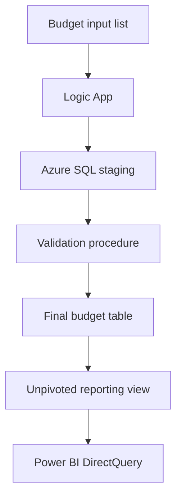

# Budget Data Integration and Automation

**Status: Reference implementation**

This project documents a budget-input pattern I have used in finance reporting: business users submit structured monthly values, an automated workflow loads them into SQL, validation runs before publication, and Power BI reads a controlled reporting layer.

The public example uses generic fields and contains no employer URLs, credentials, lists or budget values.

## Flow

## Why staging and final tables are separate

The staging table receives the latest submission without affecting report users. A stored procedure checks required fields, data types, duplicate business keys and monthly values. The final table is refreshed only after validation succeeds.

This separation makes failed loads visible and prevents a partially loaded budget from appearing in Power BI.

## Controls

- Load-run identifier, timestamp and row count
- Required-field and data-type validation
- Duplicate business-key detection
- Transactional final-table refresh
- Monthly columns unpivoted into period and amount
- Audit output for rejected rows
- Connection details supplied at deployment time, not stored in the repository

## Power BI consumption

The reporting view is shaped for DirectQuery and exposes one row per business key, scenario, period and amount. Business rules remain in SQL where they can be tested and reused; report measures handle presentation and variance calculations.

## Current limitation

The repository demonstrates the SQL and workflow design, but it is not connected to a live SharePoint list or Azure subscription. It remains a reference implementation so recruiters can review the design without needing access to private infrastructure.
