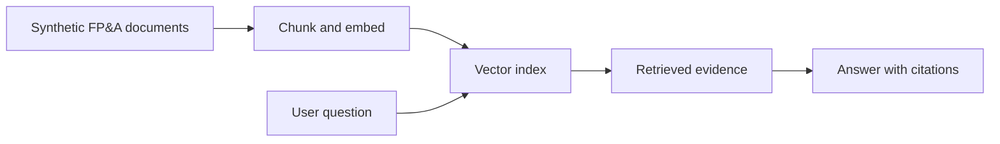

# FP&A Knowledge Assistant

**Status: Prototype**

I started this project to explore a common FP&A support problem: SOPs, KPI definitions and report guides exist, but users still spend time finding the right document or asking the reporting team.

## What works today

The current code is a small local retriever. It:

- tokenizes local text documents
- builds term-frequency vectors
- ranks passages using cosine similarity
- applies a minimum evidence threshold
- returns an unsupported-answer response when confidence is too low

This is useful for testing retrieval behaviour, but it is not yet a complete Azure OpenAI or LangChain RAG application.

## Target design

The next version will add synthetic process documents, embeddings, a vector index, a Streamlit interface, cited answers and a small retrieval-evaluation set. Azure OpenAI can be an optional provider, with a local mode so the project remains runnable without credentials.

## Production considerations

A workplace version would also need source permissions, secret management, document ownership, prompt-injection controls, logging, evaluation and a review process for outdated guidance.

I keep this project labelled as a prototype because the public code currently demonstrates retrieval foundations, not the full application described in the target design.
