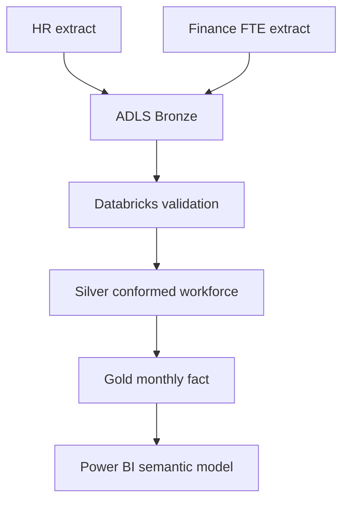

# FTE and Workforce Analytics

**Status: Reference implementation**

I created this example around a reporting problem I have worked with: finance FTE and HR headcount data come from different systems, use different keys and often require reconciliation before they can be shown together.

The design uses synthetic employee identifiers and generic entity names. It contains no employee-level or employer-confidential information.

## Reporting questions

- What is the month-end FTE and headcount?
- How much did the workforce change because of joiners and leavers?
- Which entities, functions or cost centres explain the movement?
- Do finance and HR source totals reconcile?
- Are there missing keys, duplicates or unexpected spikes?

## Proposed flow

## Model grain

The monthly fact is designed at employee surrogate key, month, entity, cost centre and employment-type level. Dimensions provide date, entity, function, geography, cost-centre and employment hierarchies.

## Measures and controls

- Month-end FTE and headcount
- Joiners, leavers and net movement
- Average FTE and base pay per FTE
- Month-on-month and year-on-year change
- Source row counts and control totals
- Duplicate and missing-key exceptions
- Threshold checks for unusual monthly movement

## Power BI design

The report would use a star schema with single-direction relationships, a dedicated measure table and access rules by region or entity. A reconciliation page would remain separate from the management view so data-quality exceptions are visible without crowding the executive pages.

## Current limitation

This folder documents the model and transformation pattern, but it does not yet contain a finished PBIX/PBIP file or dashboard screenshots. I keep it labelled as a reference implementation until those assets are added.
